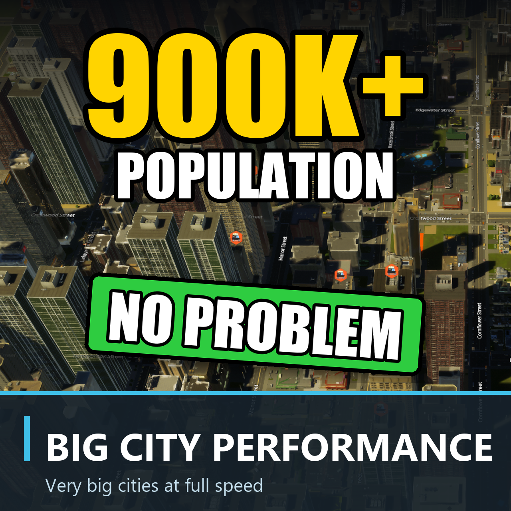

# Big City Performance



<a href="https://mods.paradoxplaza.com/mods/166756/Windows"></a>

<a href="LICENSE"></a>


A Cities: Skylines II mod that keeps very big cities running at full speed.

A city of a million people in the base game runs at about a twentieth of normal speed: vehicles and cims crawl, and a game
day takes hours. With this mod the same city runs at real time or faster on the second speed button, on a four-core laptop.

<a href="#what-it-does">What it does</a> ·
<a href="#measured">Measured</a> ·
<a href="#settings">Settings</a> ·
<a href="#what-to-expect">What to expect</a> ·
<a href="#works-with-other-mods">Works with other mods</a> ·
<a href="#saves-and-removing-the-mod">Saves and removing the mod</a> ·
<a href="#how-it-works">How it works</a> ·
<a href="#building-from-source">Building from source</a>

## Why big cities slow down

Two things, and neither is the frame rate.

- **The clock waits for routes.** Every trip needs a route, and the game gives each route request a deadline. When the
  route-finder falls behind, the simulation clock slows down and stops until it catches up. A big city asks for thousands of
  routes at once (every hour, as commuters set off), so the clock spends most of its time waiting.
- **Everyone is simulated one by one.** A million people means a million citizens deciding, walking, waiting at stops and
  re-planning trips, every few seconds.

## What it does

**Keep the clock running** (on by default):

- When the route-finder falls behind, new route requests get more time instead of the clock stopping. People set off a
  moment later; the city keeps moving. Emergency services, transit and service vehicles keep the game's own deadlines.
- While it's behind, the searches that can wait start less often until it catches up: job hunting, house hunting, school
  places, shopping and leisure trips, and empty taxis looking for passengers. A few at a time, everyone in turn, never
  all at once.
- Rush hour is spread out. The game sends everyone who starts work at the same hour off in the same second; the mod gives
  each worker a few minutes' head start of their own, so they leave across a window instead. Nobody arrives later.
- Service coverage (how far each school, clinic or station reaches) is recalculated about once a minute after a road or
  a service building changes, and every few minutes otherwise, instead of every few seconds. In a million-person city
  that recalculation was a quarter to a third of all route searches.
- Below 30 frames a second, the game lets the clock run up to twice as many simulation steps per frame, so normal speed
  stays normal speed.

**Limit the people simulated in detail** (on by default, with the limit chosen automatically):

- In a city bigger than the limit, that many people are simulated one by one. The rest stay at home, asleep. They keep
  their homes and their jobs, count in the population, earn their wages, pay rent and taxes, and still buy from the shops
  (as many sales as awake households make, spread over the shops people actually use). They just make no trips.
- Households with everyone indoors or on foot go to sleep first. When that isn't enough to reach the limit, people who
  are riding or waiting for a ride are sent home (their trip ends there, and the family car parks itself at home) and
  their household sleeps too. So the limit holds even on a computer too slow for travellers ever to get home: a
  three-million city used to keep 234,000 people awake against a limit of 40,000.
- **The streets you look at are the busy ones.** Households living around the spot the camera looks at are woken first
  and stay awake while you watch. The rest of the awake stay spread over the city.
- At overloaded stops, only the first hundred people at each place stay awake. The rest wait asleep and wake in turn as
  the ones in front board. A crowd of 1,900 at one stop is no longer 1,900 people stepping around each other and asking
  for new routes.
- While anyone sleeps, the work that covers the whole city whether or not anything changed runs less often:
  - Water and electricity are worked out again when a pipe, a cable or a connected building changes, and otherwise about
    every 17 seconds of play instead of every two. In a three-million city on a laptop short of memory that calculation
    was most of every simulation step, and running it less often cut the time lost to long frames by three quarters.
  - The counts behind demand and the statistics (households, companies, homes) run a quarter as often.
- **The limit picks itself.** It starts at 50,000 and, every 20 seconds of play, goes down a fifth when the clock falls
  behind and fewer people would help (the clock waited on routes, or the processor set the pace), or up a tenth when the
  clock keeps up with room to spare. A slow graphics card alone doesn't lower it: fewer people wouldn't draw the city any
  faster. Turn it off to pick the number yourself.
- Right after a city loads, the clock waits a moment while the first households go to sleep, instead of everyone asking
  for routes at once.
- **A count in the population box.** While the city is bigger than the limit, the population box at the bottom of the
  screen also shows how many people are simulated in detail, like `959,129 | 48k AUTO`. Hover it for the details (the
  limit, the game speed, people waiting at stops); click it to open the settings.
- Cities smaller than the limit are not changed at all.

**Hold 30 frames a second** (on by default):

- While the graphics card can't draw 30 frames a second, the game draws less detail in the distance, step by step down
  to half of your own level of detail (Options, Graphics), and gives it back when there is room to spare.
- When the processor is what's slow, drawing less wouldn't help, so nothing changes.

## Measured

The "1 Million Population City" save (about 960,000 people), on a laptop with a four-core, eight-thread processor and an
RTX 3050 laptop graphics card:

| | Game speed | Frames a second |
|---|---|---|
| The base game | 0.05× | 14 |
| The mod, normal speed (first button) | 0.9× | 20–25 |
| The mod, second button | 1.1–1.7× | 15–23 |
| The same view, paused (the graphics card's limit) | – | 28 |

Short slowdowns remain when a wave of route requests arrives at once (a big hour of commuters, say). The frame rate in a
city this size is mostly the graphics card. **Hold 30 frames a second** is what helps there: in a later session with the
graphics card warm, the first button gave 0.90× at 19 frames a second without it and 0.93× at 27 with it (detail drawn
at half).

### Three million

The "nrr 3 Million" save (2.98 million people, 98,000 buildings) on the same laptop, which has 28 GB of memory:

- **Memory comes first.** The game needs about 27 GB for this city, with or without the mod. With other programs open,
  Windows kept nearly half of that on disk, and the game ran at about a twentieth of normal speed whatever the mod did,
  with single frames lasting many seconds. For a city this size, close everything else before you load it; 32 GB is
  tight.
- Within that, version 0.3 brought the people simulated in detail from 234,000 down to the 20,000 the limit asked for
  (110,000 travellers sent home in the first minutes).
- Running the water calculation less often took the time lost to frames longer than a quarter of a second from 109 to
  29 seconds of a three-minute test, and the frame rate from 7 to 14 a second. The game's speed stayed near 0.05×: the
  route-finder, slowed by the same lack of memory, set the pace instead.
- Paused, the city draws at 19 frames a second, and at 27 with detail at half.

## Settings

Options → Big City Performance:

| Setting | Default | What it does |
|---|---|---|
| Keep the clock running | On | Everything in the first list above |
| Limit the people simulated in detail | On | Everything in the second list above |
| Choose the limit automatically | On | The limit follows how your computer keeps up |
| Most people simulated in detail (thousands) | 50 | When the automatic limit is off: lower runs faster, higher puts more people on the streets |
| Hold 30 frames a second | On | Less detail in the distance while the graphics card can't draw 30 frames a second |
| Show it in the population box | On | The count of people in detail beside the population at the bottom of the screen |

Under **Right now** the page shows what the mod is doing as you play: people simulated in detail out of the whole
population, the game speed reached over the last few seconds (1 = normal), how many people wait asleep at crowded
stops, and how much of your own level of detail the game is drawing with.

The settings are in English, German, Spanish, French, Italian, Japanese, Korean, Polish, Brazilian Portuguese, Russian
and Chinese (simplified and traditional).

## What to expect

- **Fewer people on the streets** of a city over the limit. That's the point: they're home.
- **Households take turns.** While asleep, a household doesn't age, change jobs or move. The ones asleep longest wake a
  few at a time and others go to sleep in their place, so every household gets its time awake about once every two game
  days, while the number awake stays at the limit. At most 200,000 households take their turn in a game day, so in a
  city of several million a turn comes round less often.
- **The automatic limit may settle lower than before.** The limit used to fill up with people stuck waiting at
  overloaded stops, who cost little. Now everyone it counts is really out and about, so the same number is more work:
  on the test laptop a million-person city kept normal speed at about 32,000.
- **A traveller can vanish.** When the city is over its limit (just after loading, or when the limit drops), people on
  their way are sent home so their household can sleep: a car or a walker you were watching may disappear. At the
  limit, only households with everyone indoors or on foot are picked.
- **Rush hour is gentler.** Same trips, spread over a few minutes.
- **Coverage maps update about once a minute** at normal speed after you build. A new school shows its coverage a
  little later; a change of budget can take a few minutes to show.
- **Water and power answer a change as before.** A new pipe, cable or building is worked in within a few seconds of
  play. A district that simply starts using more shows up to 17 seconds later.
- **Searches slow down** (jobs, homes, schools, shops, leisure) while the route-finder is busy, and catch up when it
  isn't.
- **Less detail in the distance** while the picture comes slower than 30 frames a second because of the graphics card.
  Turn off "Hold 30 frames a second" to keep your own level of detail whatever the frame rate.

## Works with other mods

- **Realistic Trips** works. With it and the Stutter Fix, a million-person city ran about a tenth slower in testing.
- **Service Coverage Stutter Fix** works, and the two help each other: it makes each coverage update cheaper, this mod runs them less often. On the current game version it shows its own warning popup at start: click Continue.
- **Ultra Performance & Simulation Booster** overlaps with this mod. Turn off its Pathfind Queue Unchoker, and its Optimize Parking too: a bug there opens an error popup that pauses the game.
- Don't run Ultra Performance and the Stutter Fix together. They clash with each other and show an error popup at every start.

**MapExt: Big Map, Economy and Performance** should work (read from its code, not tested in the game). If you turn on its resource buyer option, sleepers' shopping and the slower coverage updates stop.

Other mods that change simulation speed or route-finding haven't been tested with it.

## Saves and removing the mod

Sleeping households are written to a save as ordinary households, so nobody has to wake up for it. Every save is an
ordinary save that loads without the mod. Removing the mod is safe at any time.

## How it works

- The game's route requests all go through one call; the mod scales their deadlines from how close the clock is to
  stopping, doubling while it keeps stopping and halving back after a calm spell.
- Sleeping uses the entity system's `Disabled` tag, which every game system skips. The game never uses that tag itself, so
  anything carrying it belongs to the mod, and waking everyone is one search. Tags change at the end of a frame, as the
  game's own changes do.
- A traveller is sent home the way the game itself rescues a citizen it has lost track of: back in the home building
  with no errand. The walker is removed as the game removes any walker, and the game's own clean-up takes it out of its
  vehicle. A family car left without its people gets a failed route, and the game then parks it at home.
- Water and electricity are each worked out in a cycle of 128 simulation steps. The mod lets one cycle in eight start
  (one in two after the network changes) and never touches a cycle under way.
- The frame-rate hold lowers the game's own level-of-detail value and puts yours back when you turn it off or remove
  the mod.
- The game's own population count, wage and residential tax systems are given copies of their queries that include
  sleepers, so the numbers are the game's own. Sleepers' shopping goes into the game's own sales queue as sales without a
  trip, so the game moves the money and the goods itself.
- The step limit and the coverage pace are small patches with a check: if a game update changes the code they rely on,
  they leave the game alone and say so in the log.
- Every five minutes of play the mod writes a status line to `Logs\BigCityPerformance.log`: game speed, frame rate, route
  requests waiting, how many people are asleep and what they bought.

## Found a bug?

Questions and suggestions are welcome on the [forum thread](https://forum.paradoxplaza.com/forum/threads/mod-big-city-performance-million-person-cities-at-full-speed-discussion-feedback.1949141/) or in [this thread](https://discord.com/channels/263634513861541888/1568997116595150939) on the official Cities: Skylines Discord; the **Discord** button in Options opens it too.

Click **Report a bug** in Options → Big City Performance, or [open an issue](https://github.com/TevBenji/Big-City-Performance/issues). Add a screenshot and the log at
`%USERPROFILE%\AppData\LocalLow\Colossal Order\Cities Skylines II\Logs\BigCityPerformance.log`. The mod writes a status
line there every five minutes, so the log shows how the city was running.

## Building from source

**Requirements:** Windows, Cities: Skylines II, the .NET SDK 9 or later, and Node.js 18 or later. The mod targets .NET
Framework 4.8 with C# 9 and compiles against the game's own assemblies.

```powershell
git clone https://github.com/TevBenji/Big-City-Performance.git
cd Big-City-Performance/src/BigCityPerformance.UI
npm ci
cd ../..
dotnet build BigCityPerformance.sln -c Release
```

Without `npm ci` the build skips the population box bundle with a warning.

The build writes the mod to `src/BigCityPerformance/bin/Release`. If the game is not installed under `D:\Steam`, point the
build at it: `-p:ManagedPath="<Steam library>\steamapps\common\Cities Skylines II\Cities2_Data\Managed"`. Building never
installs the mod. To install a build by hand, close the game and copy everything in `src/BigCityPerformance/bin/Release`
into `%USERPROFILE%\AppData\LocalLow\Colossal Order\Cities Skylines II\Mods\BigCityPerformance`.

| Folder | What's in it |
|---|---|
| `src/BigCityPerformance.Core` | The deadline and throttle rules and the commute marker: pure C#, tested outside the game |
| `src/BigCityPerformance` | The mod: the clock, the sleeping, the bookkeeping and the settings |
| `src/BigCityPerformance.UI` | The count in the population box: React and TypeScript, bundled for the game's UI |

## Credits

Big City Performance is made by [TevBenji](https://github.com/TevBenji). The project layout started from
**[Stepped Streets](https://github.com/TevBenji/Stepped-Streets)** and **Footbridge Builder**, the same author's mods, and
before that from **[Placemaker](https://github.com/jackwrichards/placemaker)** by jackwrichards. Runtime patching uses
**Harmony** by Andreas Pardeike (MIT). The full account is in [CREDITS.md](CREDITS.md).

## Licence

Released under the [GNU General Public License v3.0](LICENSE). Cities: Skylines II is a trademark of Paradox Interactive;
this is an independent mod, not made or endorsed by Paradox Interactive or Colossal Order.
